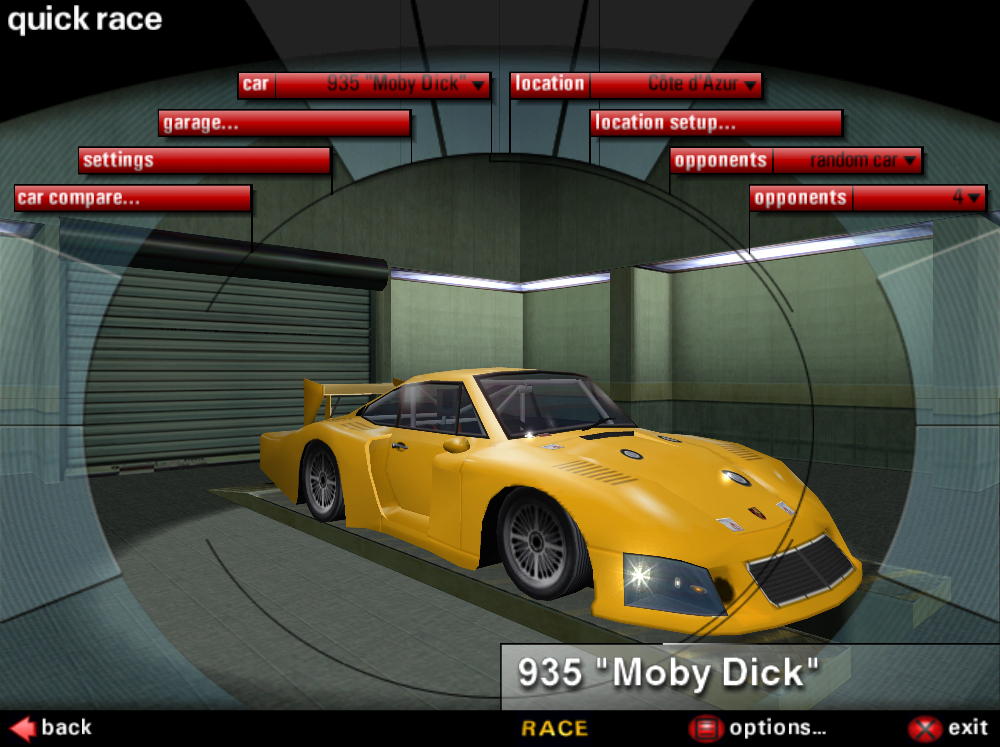
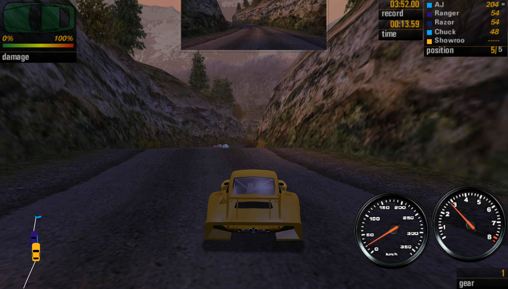

# NFS Porsche Unleashed on the web

[Play in your browser](https://daniel.lawrence.lu/nfs5/).
The original PC executable is statically translated from x86 to C with
pcrecomp and compiled to WebAssembly. Rendering uses WebGPU; the game and
its workers run on Wasm threads. The deployment is entirely static.

## Screenshots

[](docs/screenshots/935-garage.webp)

*Quick Race garage · 4404 × 3294*

[](docs/screenshots/935-mountain-race.webp)

*Mountain race · 5781 × 3291*

## Playing

The public page launches directly into the original game. Click or press a key
for sound. Select **Showroom** for the completed Evolution/Factory Driver
profile, or **Create player** for a fresh career. Arrow keys drive, Space is
the handbrake, C changes camera, and Esc opens the pause menu. The top-right
**Game menu** contains **Pause**, **Fullscreen** on supported browsers,
**Keyboard** for game text or prices, and **Info**. Touch devices can tap game
menus and use proportional joystick steering and pedals or separate arrow
buttons. **Controls** toggles the driving pad, and **Layout** changes the
layout for this browser. In portrait the controls sit below the 4:3 picture.
In landscape they sit on either side. Gas is above brake in both layouts.
Holding driving controls suppresses text selection and the iOS touch callout.
Safari uses the playback audio-session type for sound with Silent Mode enabled.

Profiles, graphics preferences and other file changes stay in IndexedDB in
this browser, per site and executable. **Exit through the game's menus to
serialize career progress.** Written files checkpoint every second and when
the tab is hidden. Clearing site data deletes local progress; closing abruptly
can lose unsaved changes. A browser confirmation guards tab close/reload until
the game exits normally; browsers control its wording and may omit it on mobile.
Deleting a supplied profile is persistent too. Losing focus releases held
controls and keeps loading/simulation running at 30 Hz using an independent
worker clock. Hidden tabs render offscreen without acquiring a compositor
surface. An animation-callback watchdog handles obscured windows too. Menus
redraw at up to 60 Hz; focused races follow the display refresh. Browser/OS
suspension can still stop background tabs.

A browser with WebGPU and shared-memory Wasm is required. Chrome and Firefox
159 with WebGPU enabled are tested on the NVIDIA GB10. Performance on other
systems still needs verification. New profiles and Showroom use maximum
exposed quality and a 32-bit viewport-sized race mode. Menus and loading artwork
keep their original 4:3 aspect, centered with black bars when needed. On hardware
adapters, frontend/garage geometry renders at the fitted monitor resolution;
original bitmap art, videos, UI layout and mouse hitboxes retain their logical
640×480 coordinates. Frontend density follows browser resize. The default
race mode fits a 4:3 frame on touch devices and the full viewport on desktop.
Explicit race resolutions retain their aspect within the available frame.
Mouse coordinates follow the fitted canvas. The system cursor is hidden over
the game.

**Info → View distance** extends the original track visibility, roadside-object
cutoffs and car/scenery LOD distances. **Automatic** uses **Far (2×)** on desktop
hardware adapters and **Original** on touch devices and software renderers.
**Very far (4×)** is available on any device. Changes apply during play and stay
in this browser, separately from career saves and the game's graphics sliders.
Higher settings retain detailed models farther away and draw more scenery;
they can reduce performance. Track-authored visibility and fog still apply, so
some transitions remain. Diagnostic reports include the selected multiplier and
original/effective section range. **Info → Atmospheric skyboxes** enables
AndrewD's sky pack on the next launch. The setting is off by default and
persists in this browser. The public build includes Zolee's high-detail
rear-spoiler correction for the 964, 993 and 996.

Adapter selection requests high performance and tries other browser preferences
before accepting a software adapter. Websites cannot override blocked drivers or
force a particular installed GPU. **Info → Copy diagnostics** includes the actual
adapter, browser, logical/output sizes, shared Wasm allocation and GPU queue stats.
Guest heap diagnostics report live allocations, free space and the largest free span.
It also reports startup/preload timing, file requests, music read-ahead hits,
audio context/session state, signal peak and refill activity,
state-cache hits/misses and the last 600 submission intervals
(median, p95, p99, maximum and counts over 33 ms), reset on size/visibility changes.
The last 32 long frames include GPU/readback wait measurements; recent ordinary
file reads include paths, timestamps, durations and calling guest threads.
When WebGPU reports a software adapter, the public page reduces the default
race mode to about 720p worth of pixels, preserving aspect and the minimum
640×480 mode, and briefly explains that hardware acceleration is preferable.
Touch devices default to at most about 1.2 million race pixels.
At most two presented frames remain queued on the
GPU, bounding accumulation on slow renderers. Frame submissions are not a
measurement of displayed frame rate.

## Current state

Startup, audio, the original frontend, profile creation, quick races and
Evolution gameplay run. A user has completed a race with correct visuals and
usable performance. Car purchases and profiles survive browser restarts.
The Showroom seed exposes the completed campaign's cars and Monte Carlo tracks.
Local browser checks run on Linux; users report playable Mac, Windows and iPhone
games with occasional stutters. Full campaign advancement remains unverified.
Multiplayer, hardware controllers, custom photo import and many unused Windows
APIs are unsupported.

The Thrash backend implements geometry, supplied texture mips, filtering,
blending/alpha tests, depth/stencil, fog, gamma, headlights, weather and
framebuffer transfers. The frontend's nearly touching picture strips share
edges to prevent subpixel black seams. Graphics queue packets are consumed
without copying contiguous payloads. A bounded cache reuses immutable rendering
states, uniforms and pipeline references, reducing allocations during play.
Graphics producers notify a consumer that may be waiting on an empty queue;
space notifications occur only while producers wait for room. Registration and
rechecks preserve wakeups, barriers and backpressure.
Identical uniform blocks and consecutive bindings are reused. Small flush hints
are combined; larger geometry batches submit early to overlap GPU and game work.
Small framebuffer reads transfer only their requested rectangle, including the
sun-visibility sample, instead of a complete 4K/6K frame. Ongoing sun occlusion
uses the latest completed GPU sample, usually one frame old, with one query in
flight per sun. Loading-screen locks sample the logical UI pixels on the GPU
before transfer. Full-resolution framebuffer reads remain available.
At most four small GPU readback buffers are retained for reuse; large screenshot
buffers are released after each read.
Sun/light sprite rotation
uses the original 640×480 angular scale rather than increasing with resolution.
**Sustained 4K/120 Hz remains a target, not a verified result.** Microstutters,
intermittent menu input retries and a previously observed menu-return fault
still need investigation. Warm local race samples show occasional 30–60 ms
intervals even without asset requests. Sun sampling reduces synchronization
overhead, but occasional long frames remain. Audio refills reuse the thread
already holding the VM lock; host refill ticks skip a busy VM instead of blocking
the graphics worker. No Wine reference runs are needed for normal work.

Public startup batches small assets and music headers/tails into an approximately
10 MiB pack (3.6 MiB compressed), downloaded alongside Wasm compilation.
Larger files use byte ranges with an eight-page, 256 KiB/page cache. Contiguous
cold pages requested by a single read share one transfer of up to 2 MiB.
Writable browser saves override immutable preloads. Downloads stage privately
and release the shared game lock. Source changes during I/O reject stale data.
First-time download and compilation depend on the connection and device.

Music uses a separate fixed 12 MiB read-ahead cache. It retains the complete
current song and prefetches a candidate next song, with at most two background
HTTP requests, each combining up to four 256 KiB pages. Resident song headers
avoid metadata downloads on selection; warmed songs play without further HTTP.
Music prefetch can continue during play. The complete 112 MiB archive is never
loaded into memory. Track/car geometry and sound effects are loaded by the
original loading routines; a three-minute race network capture showed music
requests only. Invalid responses or worker failures retain ordinary file I/O.
Cold reads, CPU scheduling and occasional GPU stalls remain possible.

The engine uses a 256 MiB guest arena in initially 384 MiB shared Wasm memory,
an eight-worker pool and an approximately 84 MiB Wasm module (8.8 MiB gzip).
It preserves integer MMX, uses double-precision x87 helpers and retains
execution diagnostics; complete binary compatibility is not established. Memory
can grow with a 16 MiB linear step. Browser/GPU/code memory is additional to the
shared arena. The guest allocator merges adjacent free spans and reuses alignment
gaps. Display teardown and smaller modes release oversized framebuffer locks.
JavaScript consumers refresh their byte view when a game thread grows shared
memory, including while GPU readbacks are pending. Race loading is tested with
the 911 GT1 and four opponents on Auvergne at 1280×960, 4K and 6K; the 6K case
uses about 453 MiB of shared Wasm memory.

## Development

Prerequisites: Git, Python 3.10+, Node 18+, npm, and Chrome for browser checks.
Downloaded tools, build outputs, caches and test profiles stay in this checkout.
Supply matching game files and Verok's patch; preparation/staging only read them.

```sh
python3 tools/bootstrap.py
.venv/bin/python tools/prepare.py "/path/to/installation/nfs5.exe"
python3 tools/stage_assets.py "/path/to/installation"
npm run build
npm test
npm run serve
```

The development launcher is at <http://127.0.0.1:8000>. Use **Run game** for
normal play; **Run original startup** is a bounded diagnostic. Browser checks:

```sh
npm run test:browser
npm run test:navigation
npm run test:loading
npm run test:races
npm run test:detail
npm run test:io
npm run test:renderer
npm run test:usability
```

Tests cover original-code comparisons, services, threads, input, audio,
persistence, lifecycle and GPU pixels/transport, including 4K output and
picture-strip seams and GPU readbacks after another worker grows memory.
Asset tests cover verified startup packs, optional skybox selection, writable overrides, bounded read-ahead,
claimed-page eviction protection, exact tail bytes and range fallback;
audio checks verify that a busy VM cannot block refill ticks.
Audio-session checks cover playback routing, resume and cleanup.
Sun-query checks cover delayed completion, sample reuse, one outstanding query,
resize/reset invalidation, exact ordinary reads and asynchronous failure handling.
Public checks cover wide/portrait menu fitting and
clicks with black-bar offsets; loading checks verify 4:3 artwork and the
full-width race canvas at wide, portrait and 4K sizes. Usability checks cover
touch input, proportional native steering/pedals in a running race, short Escape
presses, controls outside the picture in both orientations, held pedals without
text selection, mobile text and price entry, and real hidden-tab
loading/racing; the latter uses raw Chrome CDP because Playwright forces tab
visibility. Python Pillow is required for screenshot checks. Reports and
screenshots go to ignored `build/` files.
Scene-detail checks compare native section ranges against independent x86
execution, switch Original/2×/4× in live races on Normandie, Côte d'Azur and
Auvergne, and record geometry counts, submission intervals and Wasm memory.
`NFS5_RACE_DETAIL=very-far npm run test:races` exercises four opponents through
6K with the maximum override. `NFS5_CHROME` selects the executable for the
scene-detail browser check, including an isolated Wayland wrapper.
The I/O concurrency check holds real HTTP responses for 600 ms, verifies that
other VM clients can run, and replaces a source mid-read to reject stale bytes.
Pacing checks cover missing animation callbacks, focus transitions and menu caps;
the raw-CDP race usability check keeps a race hidden for over a minute.
`NFS5_GPU_SOFTWARE=1 npm run test:loading` selects SwiftShader explicitly.
`python3 tools/build.py --profile` emits a Wasm symbol map.

## Public release

```sh
npm run build:public
python3 tools/serve.py --directory build/public --port 8001
python3 tools/deploy_public.py
```

The packager reads `.cache/mods/spoiler-fix.zip` and
`.cache/mods/atmospheric-skyboxes.zip` when present. Supply different archive
paths with `npm run build:public -- --spoiler-fix PATH --skyboxes PATH`.
The optional skybox payloads load on demand when selected.

With the public preview running, `npm run test:public` checks direct launch,
blank-profile defaults, mobile name entry, native-density 4:3 output, adapter
diagnostics, tab-close confirmation and persistence across a browser restart. This
check uses Python Pillow for rendered-screen readiness. Set `NFS5_PUBLIC_URL`
to run it against the deployment instead.

The public packager includes only referenced assets, strips installation
players/replays/records, and supplies Showroom plus the original blank-profile
template. JavaScript, styles and worker dependencies carry a content-derived
release version to prevent mixed releases. Wasm and game assets use immutable
content-hash URLs, allowing browser download/compilation caches to survive UI-only
releases. The packager downloads a hash-pinned completed-save archive (requires
libarchive); attribution is in [third-party notices](THIRD_PARTY_NOTICES.md).
User profiles and deletion records overlay these defaults on subsequent runs.
Original binaries, saves and generated game code are not committed to Git.

Deployment copies `build/public/` to `pupserver.linode:/www/misc/nfs5`.
[The Caddy fragment](tools/nfs5.caddy) limits cross-origin isolation headers
to `/nfs5`, serves precompressed Wasm, and caches content-addressed assets.
The deploy script backs up and validates Caddy's configuration before reload.
A different static host must supply `Cross-Origin-Opener-Policy: same-origin`
and `Cross-Origin-Embedder-Policy: require-corp`; byte ranges are recommended.
The staged installation is about 531 MiB and is public when deployed.

See the [progress diary](diary/) for measurements and verification limits.
